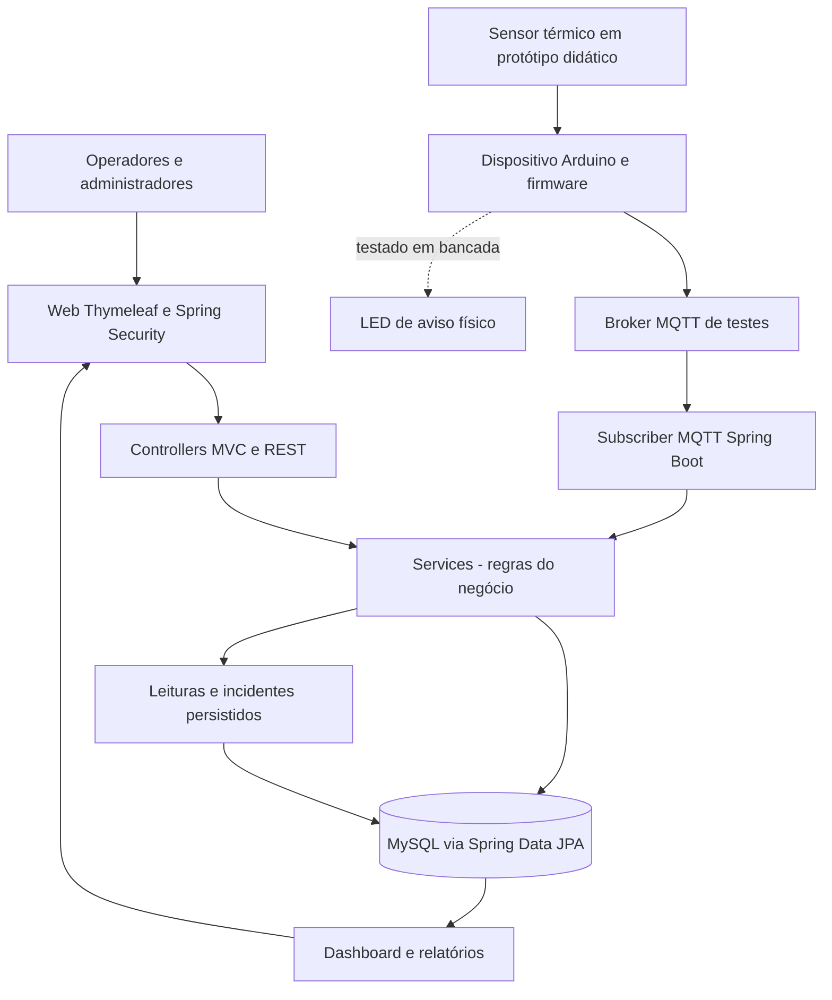

# Arquitetura — FlangeGuard

**Base:** TAP (Arquitetura do Sistema, Banco de Dados) e TCC (RF05–RF15, RN01–RN08).

## Componentes existentes no repositório

A comunicação real com Arduino exige um firmware, broker e dispositivo configurados
e um **teste separado**. O desenho descreve a integração proposta, não certificação
ou operação industrial comprovada.

### Persistência e integridade

- `Flange` relaciona-se com `Unidade`.
- `Sensor` possui identificação e vínculo com uma `Flange`.
- `LeituraSensor` registra temperatura, momento, origem, sensor e flange.
- `Incidente` pode representar eventos de telemetria e mantém dados do alerta,
  reconhecimento e normalização; registros legados agregados permanecem distintos.
- `Manutencao` associa flange e funcionário responsável e possui arquivamento lógico.
- `Usuario` e `Funcionario` são entidades distintas, com vínculo opcional e regras
  de unidade.

### Monitoramento

1. Dispositivo autorizado publica no tópico previsto, com identificador único de evento.
2. `MqttTelemetriaSubscriber` valida o tópico e encaminha o payload ao `TelemetriaService`.
3. `TelemetriaService` valida o sensor, token e payload, registra a leitura e
   cria/atualiza uma ocorrência se um limiar aprovado ou sinal explícito indicar anomalia.
4. O alerta permanece aberto até reconhecimento e normalização autorizada.
5. O dashboard usa consultas limitadas às leituras recentes e mantém o histórico
   consultável nos módulos próprios.
6. `/api/monitoramento/resumo` fornece apenas contagem de alertas e instante da
   última leitura da unidade permitida (visão global somente para ADMIN); o navegador
   verifica mudanças a cada 7 segundos e oferece recarregamento da página.
7. Sem leituras ou com falha de comunicação, **não se presume que tudo está normal**.

### Segurança e limites

- Senhas das contas são armazenadas com BCrypt, conforme `SecurityConfig`.
- Credenciais do dispositivo são validadas no serviço de sensores; nunca enviar
  tokens para o repositório ou para logs.
- USER possui escopo da própria unidade; ADMIN tem visão global.
- A aplicação auxilia na identificação de **possíveis anormalidades**, não confirma
  vazamento nem substitui avaliação e procedimentos de segurança industrial.
- Não há valores universais de limite térmico ou garantia de tempo de resposta:
  exigem definição técnica e medições reais.
